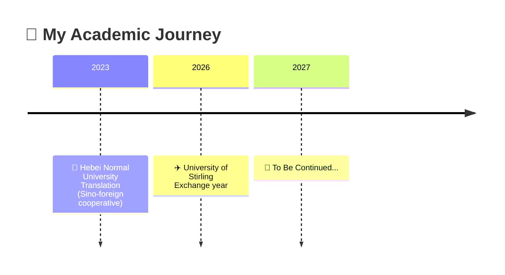

  

  

  <b>English</b> | <a href="README.zh-CN.md">简体中文</a>

---

### 🧸 About Me

- 🎓 Undergraduate in Translation (Sino-foreign cooperative programme), Class of 2023,
  Hebei Normal University
- ✈️ One-year exchange at the **University of Stirling**, UK, starting September 2026
- 📖 Passionate about languages, technology and cross-cultural communication
- 💡 Using AI tools to speed up translation, and code to solve practical problems
- 🌱 Exploring what AI + translation can do together

---

### 🗺️ Education

| 📅 Period | 🏫 Institution | 📚 Programme |
| :---: | :---: | :---: |
| 2023 - 2026 | Hebei Normal University | Translation (Sino-foreign cooperative) |
| 2026 - 2027 | University of Stirling | Translation & Interpreting |

---

### 🛠️ Skills

  
  
  
  

  
  
  
  
  
  

> 🔥 **What I do best:** writing scripts and building websites with AI tools, and making translation
> work faster and smoother.

---

### 🚀 Projects

*📌 More projects on the way — stay tuned.*

| 🛠️ Project | 📝 Description | 🏷️ Tech |
| :---: | :--- | :---: |
| 📝 [Translation blog](https://waterc0loreyes.github.io) | 20+ essays on translation practice and reflection, covering EN→ZH and ZH→EN | Hexo + Markdown |
| 💻 Personal website | Technical explorations and study notes | - |
| 🌐 More projects | Coming soon | - |

---

### 📊 GitHub Stats

  

  

---

### 📫 Connect With Me

  
  

  <i>📬 Always happy to talk and collaborate — feel free to reach out!</i>

---

  

