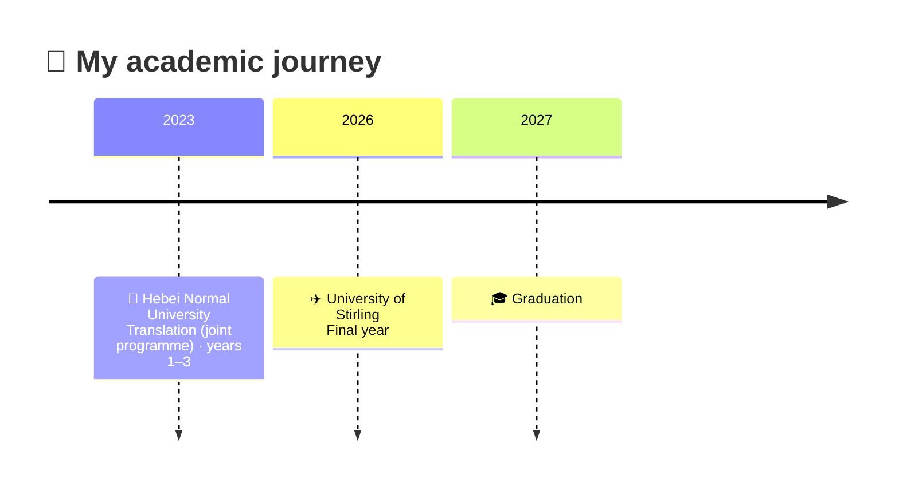

  

  
  
  

  <b>English</b> · <a href="README.zh-CN.md">简体中文</a>

---

## 🚀 Featured projects

### 🎬 AI Subtitle & Article Translator

A self-hosted translation site for subtitles and articles: drop in a VTT/SRT file or paste an
article, and DeepSeek translates it sentence by sentence — side-by-side review, inline editing,
AI annotations, and export to VTT / SRT / TXT / CSV.

  
  
  
  
  

**[Backend](https://github.com/Waterc0lorEyes/automated-translation)** ·
**[Frontend](https://github.com/Waterc0lorEyes/automated-translation-web)** ·
**[Live demo](https://tomatocat.art)**

### 📝 Translation blog

20+ essays on translation practice and reflection — EN→ZH and ZH→EN, plus the occasional detour
into the tooling behind it.

`Hexo` · `Markdown` · **[waterc0loreyes.github.io](https://waterc0loreyes.github.io)**

---

## 🧸 About me

- 🎓 Translation major in a **joint programme** between Hebei Normal University and the **University of Stirling**
- 🏫 First three years at Hebei Normal University, final year at Stirling (2026 – 2027)
- 📖 Into languages, technology and cross-cultural communication
- 💡 Using AI tools to speed up translation and code to solve real problems
- 🌱 Exploring what AI + translation can do together

---

## 🗺️ Education

| 📅 Period | 🏫 Institution | 📚 Programme |
| :---: | :---: | :---: |
| 2023 – 2026 | Hebei Normal University | Translation (joint programme) · years 1–3 |
| 2026 – 2027 | University of Stirling | Translation |

---

## 🛠️ Toolbox

  
  
  
  

  
  
  
  
  
  
  
  

---

## 📊 GitHub at a glance

  
  
  
  

---

## 📫 Let's talk

  
  
  

  <i>📬 Happy to talk translation, tooling, or anything in between — feel free to reach out.</i>

---

  

