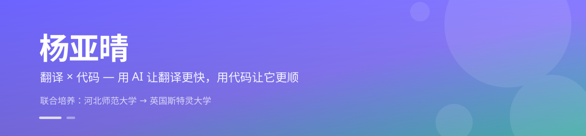
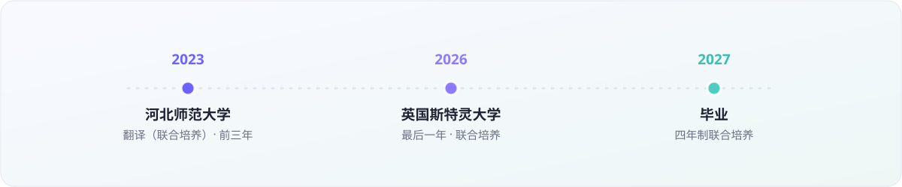

  

  
  
  

  <a href="README.md">English</a> · <b>简体中文</b>

---

## 🚀 主要项目

### 🎬 AI 字幕 & 文章翻译

自托管的字幕 / 文章翻译站：上传 VTT/SRT 字幕或粘贴文章，DeepSeek 逐句翻译——逐句对照、
人工编辑、AI 注释，支持导出 VTT / SRT / TXT / CSV。

  
  
  
  
  

**[后端仓库](https://github.com/Waterc0lorEyes/automated-translation)** ·
**[前端仓库](https://github.com/Waterc0lorEyes/automated-translation-web)** ·
**[在线体验](https://tomatocat.art)**

### 📝 翻译学习博客

20+ 篇翻译实践与反思——英译汉、汉译英，偶尔也聊聊背后的工具。

`Hexo` · `Markdown` · **[waterc0loreyes.github.io](https://waterc0loreyes.github.io)**

---

## 🧸 关于我

- 🎓 翻译专业，**河北师范大学与英国斯特灵大学联合培养**
- 🏫 前三年在河北师范大学，最后一年在斯特灵大学（2026 – 2027）
- 📖 热爱语言、技术与跨文化交流
- 💡 善于用 AI 工具提升翻译效率，用代码解决实际问题
- 🌱 正在探索 AI + 翻译的无限可能

---

## 🗺️ 教育经历

  

---

## 🛠️ 技能工具箱

  
  
  
  
  
  
  
  

另外：AI 辅助翻译、术语管理，以及不少脚本活儿。

---

## 📫 联系我

  
  
  

  欢迎交流翻译、工具，或者任何你感兴趣的话题。

